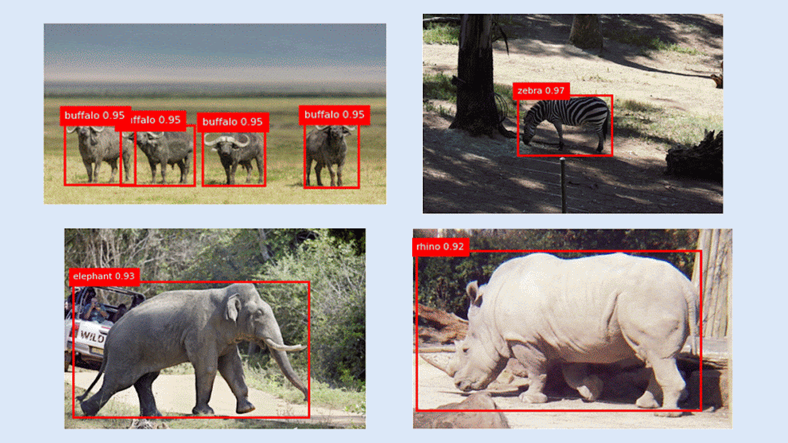
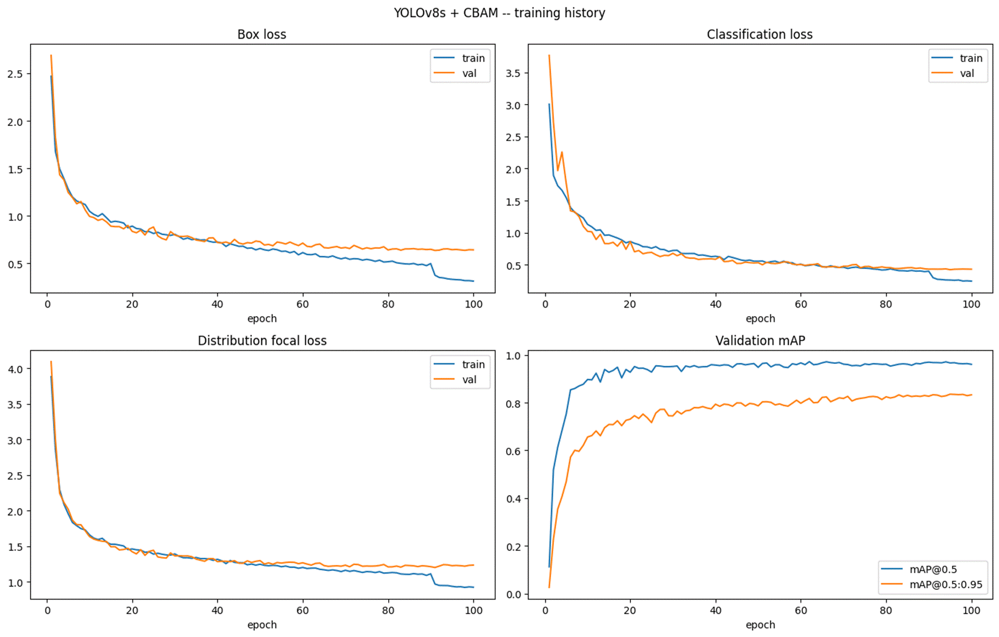
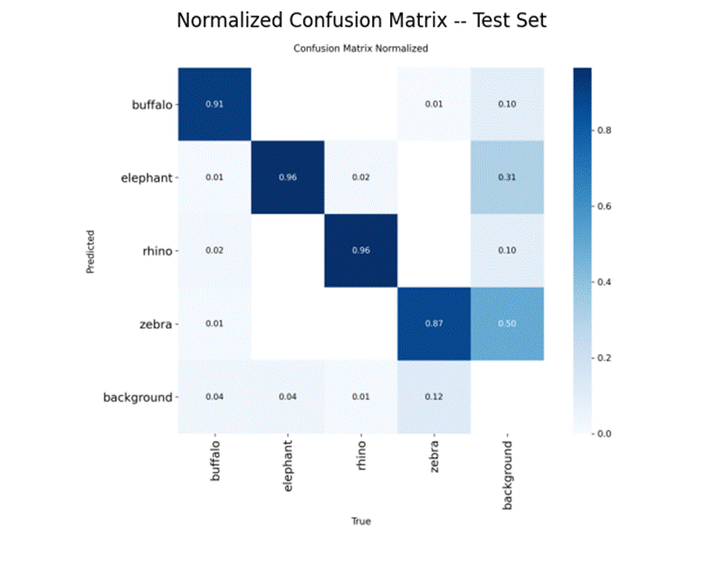
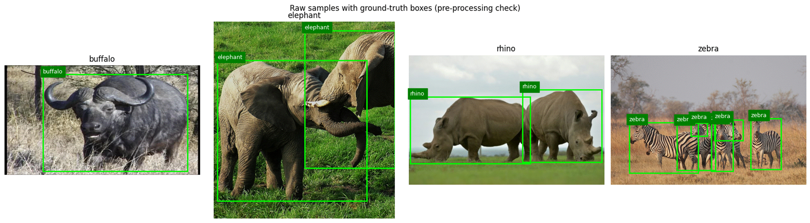
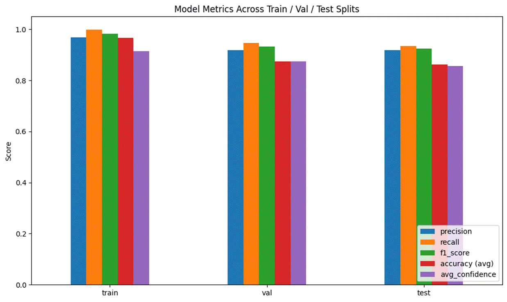

# African Wildlife Detection

Real-time detection of buffalo, elephants, rhinos, and zebras with YOLOv8s and CBAM attention.

Camera traps and drone surveys produce more images than rangers can review, and the animals in them are often far away, in herds, or half-hidden by grass and trees. This project is an object detector that finds and labels four African species in natural photographs, fast enough for camera-trap and drone footage: a YOLOv8s model with a CBAM attention block at each of its three detection scales.

A course project for CS190-4P Computer Vision and Image Processing, a third-year course, by a team of three.

## Results

Scored once on 228 held-out test images the model never saw, after the best checkpoint was chosen on validation.

| Metric | Test |
| --- | --- |
| mAP@0.5 | **0.958** |
| mAP@0.5:0.95 | **0.818** |
| Precision | **0.971** |
| Recall | 0.886 |
| F1 (IoU ≥ 0.5, confidence ≥ 0.25) | 0.925 (0.932 on validation) |
| Speed | **13.9 ms per image (72 FPS)** on one Colab Tesla T4 GPU |

| Class | Precision | Recall | mAP@0.5 | mAP@0.5:0.95 |
| --- | --- | --- | --- | --- |
| Buffalo | 0.971 | 0.837 | 0.956 | 0.830 |
| Elephant | 0.959 | 0.909 | 0.980 | 0.817 |
| Rhino | 0.988 | 0.976 | 0.990 | 0.899 |
| Zebra | 0.967 | 0.823 | 0.907 | 0.726 |

| | |
| --- | --- |
|  |  |
|  |  |

## Method

1. **Data you can trust.** Every one of the 1,504 photos (2,685 labelled animals) was checked for a label file and valid boxes. None were missing or malformed.
2. **Balanced splits.** 70/15/15 within each species with a fixed seed: 1,049 training, 224 validation, and 228 test images.
3. **Augmented only where it helps.** Mosaics, flips, and colour jitter on training images only, switched off for the last 10 epochs.
4. **YOLOv8s with attention.** A one-pass detector, chosen over slower two-stage detectors. A CBAM block at each of the three detection scales helps the model weigh the right features and ignore cluttered backgrounds. The three blocks add about 43,300 parameters, 0.4% of the model. The custom module is registered with Ultralytics at runtime and checked with a test forward pass before training.
5. **Transfer learning.** Started from COCO-pretrained weights and fine-tuned for 100 epochs, about 48 minutes on a free Colab GPU.
6. **Checked twice.** Ultralytics mAP, plus a separate IoU-matching evaluation for precision, recall, and F1, which agreed with the library's metrics.
7. **Speed.** 50 timed runs after 5 warm-ups, GPU-synchronised.

## Limits

- Zebras are the hardest class: the lowest recall (0.823) and the most missed animals, mostly in herds or partly hidden.
- What CBAM adds is not measured yet. No plain YOLOv8s was trained for comparison, so the gain from attention is unproven.
- The photos are mostly hand-held wildlife photography, not camera-trap footage, and the model hasn't been tested in the field.

## Repository contents

| Path | Contents |
| --- | --- |
| `notebooks/african_wildlife_yolov8s_cbam.ipynb` | The final notebook: data audit, split, model, training, and evaluation. Outputs are kept. |
| `figures/` | The result charts and sample detections. |

The dataset and the trained weights are not included.

## How to run

The notebook was written for Google Colab and reads the dataset from Google Drive.

1. Download the [African Wildlife dataset](https://www.kaggle.com/datasets/biancaferreira/african-wildlife) from Kaggle.
2. Put its four class folders (`buffalo`, `elephant`, `rhino`, `zebra`, each with `.jpg` images and YOLO `.txt` labels) in your Google Drive at `MyDrive/CS190-4P/YOLO/`.
3. Open the notebook with the **Open in Colab** badge above and choose a GPU runtime (**Runtime → Change runtime type → T4 GPU**).
4. Run the cells in order and allow the Drive mount when asked. Training takes about 48 minutes on a T4. Weights and plots are copied back to `MyDrive/CS190-4P/YOLO/_experiment_outputs/`.

Retraining gives results close to, but not always exactly, the ones above, because GPU training is not fully deterministic.

## Data source

[African Wildlife](https://www.kaggle.com/datasets/biancaferreira/african-wildlife) by Bianca Ferreira on Kaggle: 1,504 images of buffalo, elephants, rhinos, and zebras with YOLO-format box labels. Ultralytics also documents it as the [African Wildlife detection dataset](https://docs.ultralytics.com/datasets/detect/african-wildlife/). The source does not state a license, so the images are not redistributed here; the sample images in `figures/` come from it.

## Team

A team of three: **Indaya**, **Pernia**, and **Vinluan**.

Jherwin Indaya was the machine learning developer: audited, split, and prepared the data, designed and built the model, and trained and evaluated it.

## License

The code and notebook are released under the [MIT License](LICENSE). The dataset keeps its own terms.
